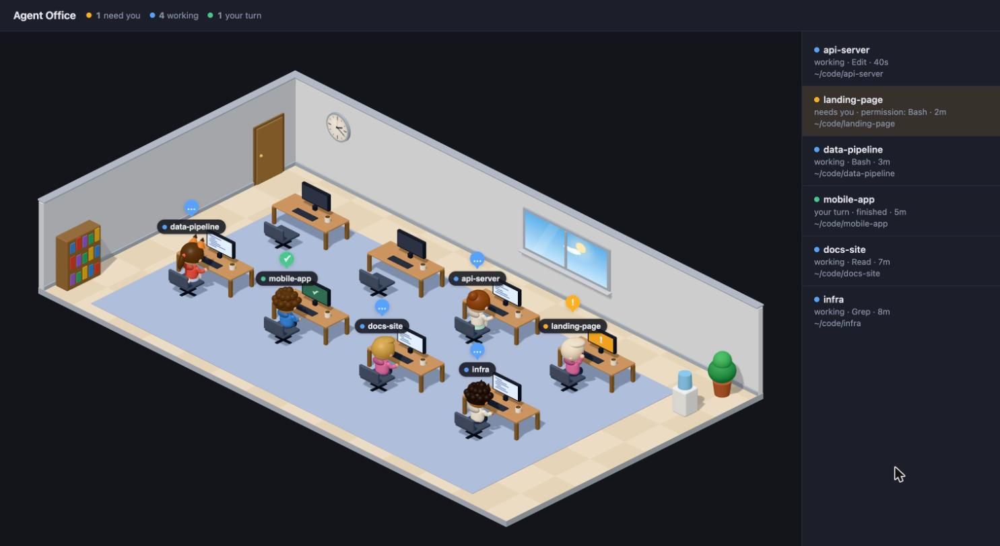
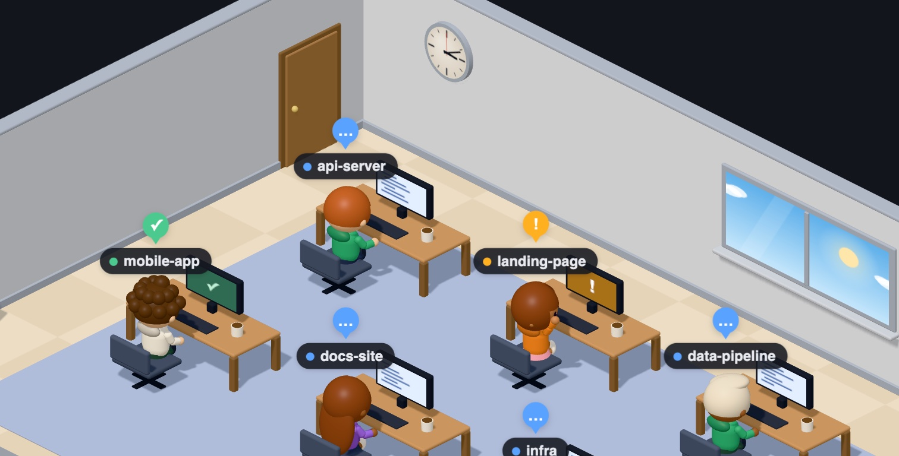
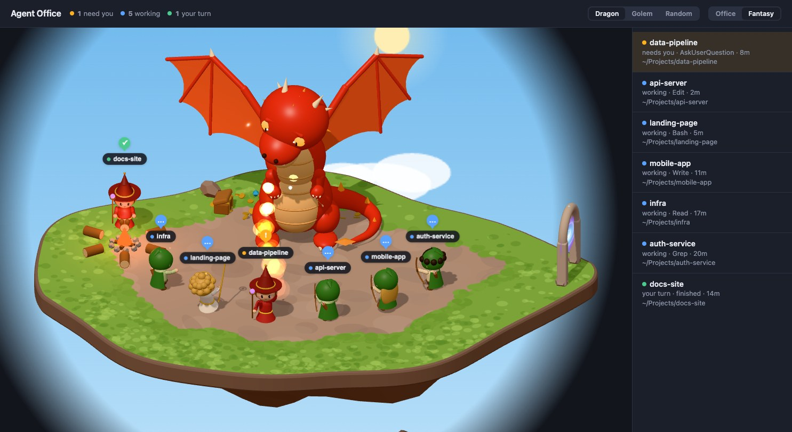
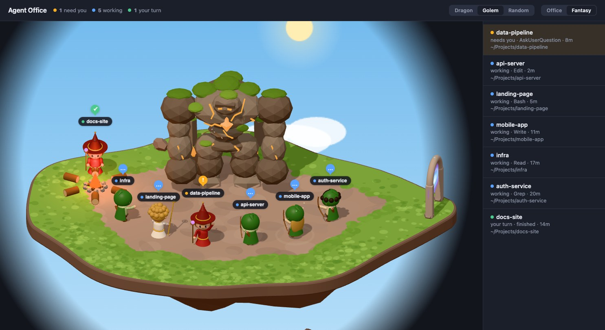

# Agent Office

A tiny 3D office in your browser that shows your live Claude Code sessions, plus macOS
notifications when one of them needs you. Prefer dragons? Switch to the fantasy theme, where your sessions
are an adventuring party fighting a big red dragon or an earth golem.









<sub>Screenshots use made-up demo sessions.</sub>

- **One desk per live session.** Little toy figures walk in when a session starts, sit down at a desk, and
  walk out when it closes. Each session gets its own look (hairstyle, hoodie colour).
- **At-a-glance states:** ⚙ working (typing, code on screen) · ⚠ needs you (permission prompt or a
  question; waving, flashing screen) · ✓ your turn (finished; sitting idle, green screen).
- **Two themes:** switch between them with the toggle at the top right; your browser remembers the choice.
  - **Office:** desks, a window with a sky that follows your local time, a wall clock.
  - **Fantasy:** each session is a warrior, mage, archer or priest (picked at random, fixed per session).
    Working = fighting the Foe (sword swings, fireballs, arrows, heals), needs you = turns to you and waves,
    your turn = resting at the campfire. Party members come and go through a portal. The Foe sleeps when
    nobody is working, and the sky behind the island follows your local time.
  - **Foes:** pick Dragon, Golem or Random (the default, rolled each time the page loads) next to the theme
    toggle. The red dragon breathes a sweep of fire and roars; the earth golem slams the ground and pounds its
    chest. Hits make the Foe recoil instead of flashing, so nothing on screen strobes.
- **No clutter:** sessions that finished and haven't been touched for 30 minutes are hidden.
  Closed sessions disappear right away.
- **Readable names:** your `--name` / `/rename` if you set one, otherwise Claude's automatic topic
  title, otherwise the folder name.
- **Notifications:** a macOS banner (with sound) when a session needs you or finishes, whether or not
  the office is open.
- **Self-contained:** built-in Python 3, one HTML page with a few small JS modules, and a bundled copy of [Three.js](https://threejs.org)
  in `vendor/`, so nothing is fetched from the internet. The server listens on `127.0.0.1` only.
- **Light on battery:** the 3D view runs at 60 fps while you're looking at it, about 30 fps when another
  window has focus, and pauses while the tab is hidden.

## Requirements

macOS with `/usr/bin/python3` (ships with the Xcode Command Line Tools), Claude Code, and a browser with
WebGL (any current Chrome, Safari or Firefox). Without WebGL the page still shows the session list.

## Install

```sh
git clone https://github.com/iamkelvinsaputra/agent-office.git ~/Projects/agent-office
~/Projects/agent-office/install.sh
```

`install.sh` backs up your `~/.claude/settings.json`, adds hooks that run `hook.py` from this folder,
and links `agent-office` into `~/.local/bin`. Run it again whenever you move the folder.

New Claude Code sessions pick up the hooks. Then:

```sh
agent-office          # opens http://127.0.0.1:47823/  (Ctrl-C to stop)
```

Set `AGENT_OFFICE_PORT` to use another port. To start in the fantasy theme in browsers that haven't picked a
theme yet, run `agent-office --theme fantasy` (or set `AGENT_OFFICE_THEME=fantasy`). If the server is already
running, stop it first so the new default applies.

While it runs on macOS, `agent-office` also runs `caffeinate -d` so the Mac doesn't sleep (the screen stays on,
but you can turn the brightness all the way down). Closing the lid on battery still puts it to sleep. Pass
`--no-caffeinate` (or set `AGENT_OFFICE_CAFFEINATE=0`) to turn this off.

## How it works

| File | Role |
|---|---|
| `hook.py` | Runs on Claude Code hook events. Writes each session's state to `~/.local/state/agent-office/` and sends notifications. Always exits 0 so it can never block Claude Code. |
| `server.py` | Merges hook state with Claude Code's own live-session list (`~/.claude/sessions/`), applies the visibility rules, and serves the page plus `/api/state`. |
| `office.html` | The page: header, theme and Foe toggles, session list. |
| `js/app.js` | Renderer, camera, name tags, render loop, polling, theme switching. |
| `js/crowd.js` | Who walks where: arrivals queue at the entrance, walk to their spot, move, and leave without bumping into each other. |
| `js/figure.js` | The shared toy figure (body, face, hair) that each theme dresses. |
| `js/sky.js` | The time-of-day sky (sun, moon, stars, clouds). |
| `js/themes/office.js`, `js/themes/fantasy.js` | The two themes: world, outfits, poses, and what each state looks like. |
| `js/themes/foes/` | The fantasy theme's Foes (`dragon.js`, `golem.js`): each builds its body and scenery and poses itself; `fantasy.js` runs their shared rhythm and hit recoil. |
| `vendor/` | Three.js r169 (`three.module.min.js`, `RoundedBoxGeometry.js`), MIT licensed, see `vendor/THREE-LICENSE`. |
| `common.py` | Shared paths and session naming. |
| `settings_hooks.py` | Adds or removes this project's hooks in `settings.json` without touching anything else. |

Sessions that were already running before you installed still appear (as working / your turn) from
Claude Code's session list; "needs you" and notifications need a session started after install.

## Uninstall

```sh
~/Projects/agent-office/uninstall.sh
```

Removes the hooks, the `agent-office` command and the saved state. Then delete the folder.

## License

MIT. See [LICENSE](LICENSE). Three.js in `vendor/` is MIT licensed by the three.js authors; see `vendor/THREE-LICENSE`.
